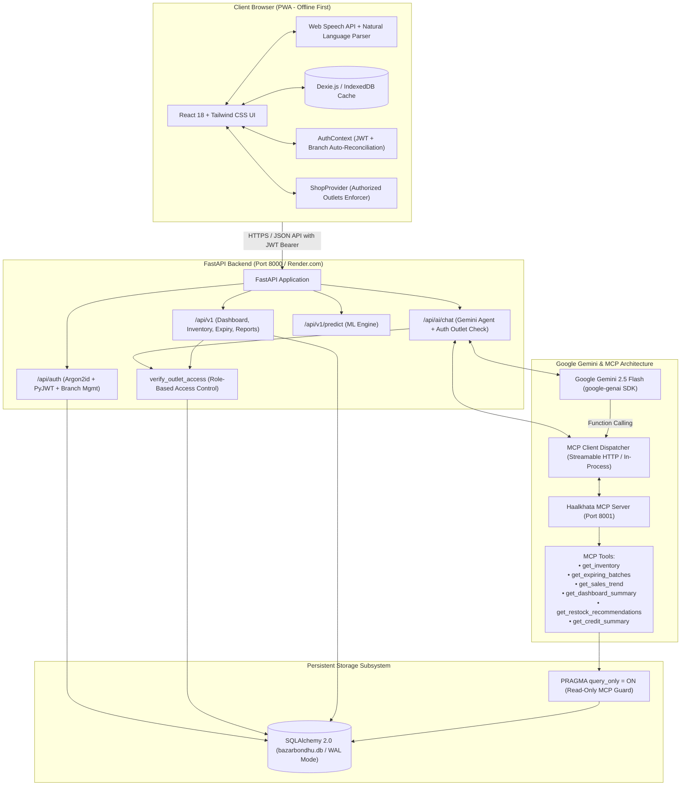
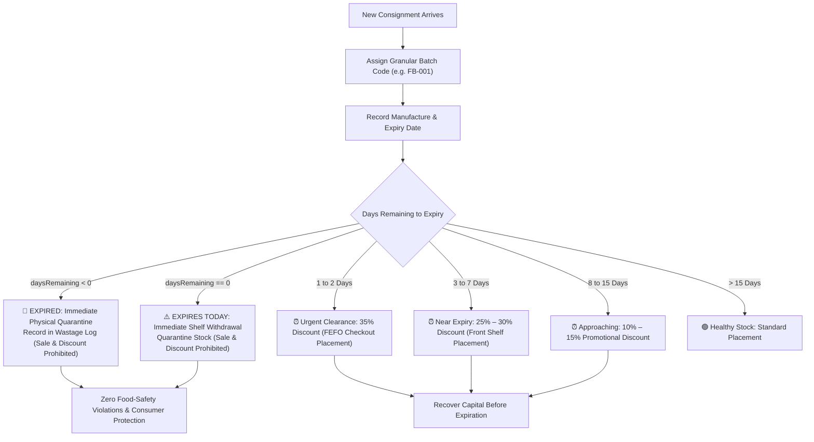

<p align="center">
  
</p>

<h1 align="center">হালখাতা (Haalkhata)</h1>
<h3 align="center">AI-Powered Smart Digital Ledger & Grocery Retail Operating System</h3>

<p align="center">
  <em>ঐতিহ্যবাহী কাগজের খাতা থেকে আধুনিক এআই চালিত সুপারশপ ও মুদি দোকান ব্যবস্থাপনা</em>
</p>

<p align="center">
  <a href="https://github.com/Synity-Soft/Hat-Bazar/actions"></a>
  <a href="https://haalkhata-vjfs.onrender.com/docs"></a>
  <a href="https://react.dev/"></a>
  <a href="https://ai.google.dev/"></a>
  <a href="https://modelcontextprotocol.io/"></a>
  <a href="https://www.typescriptlang.org/"></a>
  <a href="https://scikit-learn.org/"></a>
  <a href="#license"></a>
</p>

<p align="center">
  <a href="#-key-highlights">Key Highlights</a> •
  <a href="#-core-features">Core Features</a> •
  <a href="#-system-architecture">Architecture</a> •
  <a href="#-mcp-ai-agent-system">Gemini AI & MCP</a> •
  <a href="#-fefo--food-safety-expiry-strategy">FEFO & Food Safety</a> •
  <a href="#-technology-stack">Tech Stack</a> •
  <a href="#-getting-started-local-development">Getting Started</a> •
  <a href="#-api-documentation">API Docs</a>
</p>

---

## 📖 Overview

**হালখাতা (Haalkhata)** is a resilient, offline-first Retail Operating System and AI-powered Digital Ledger engineered specifically for Bangladesh's 1.5M+ neighborhood grocers (মুদি দোকানি). 

Traditional grocery retail in South Asia suffers from **12–18% gross margin loss** due to unmonitored product expiry, **15–20% uncollected credit debts** from fragile paper notebooks, and frequent stockouts caused by guesswork purchasing. 

**হালখাতা** bridges this gap by combining the speed and familiarity of traditional Bengali shopkeeping with cutting-edge **Google Gemini AI + Model Context Protocol (MCP) intelligent agents**, **Machine Learning demand forecasting**, **bilingual natural language voice bookkeeping**, **strict FEFO expiry food-safety compliance**, and **multi-branch enterprise ownership security**.

---

## 🌟 Key Highlights

| Feature | Traditional Grocery | হালখাতা (Haalkhata) |
| :--- | :--- | :--- |
| **Connectivity** | Freezes during load-shedding / internet drops | **100% Offline-First (Dexie IndexedDB)** Instant local writes |
| **AI Copilot** | None / Generic disconnected chatbots | **Google Gemini 2.5 Flash + Autonomous MCP Tools** Connected to live outlet database |
| **Bookkeeping** | Hand-written paper khatas prone to damage | **Voice AI Bookkeeping** (Bangla & English spoken entries) |
| **Customer Credit** | Forgotten dues & awkward verbal requests | **Automated SMS Reminders** with 1-click repayments |
| **Product Expiry** | Expired stock dumped as total financial loss | **Strict Food Safety Quarantine & Safe FEFO Markdown Liquidation** |
| **Multi-Branch Security** | Insecure shared passwords & cross-store data leaks | **Argon2id Hashing, 24h JWT, & Strict Outlet Authorization Boundaries** |
| **Restocking** | Manual guesswork & supplier overcharging | **7D/30D ML Forecasting + Wholesale Price Comparison** |
| **Emergency Stock** | Turning customers away when out of stock | **Neighborhood Shop Network** (Peer borrowing & overstock trade) |

---

## 🚀 Core Features

### 🤖 1. Google Gemini AI + Autonomous MCP Business Copilot
- **Conversational Intelligence:** Submit natural language questions in colloquial Bengali or English (`/assistant`).
- **Autonomous Tool Execution (Model Context Protocol):** Gemini dynamically queries the centralized database through standardized MCP tools:
  - `get_inventory`: Queries stock quantity, unit pricing (BDT), and categories.
  - `get_expiring_batches`: Inspects near-expiry batches across 7-day and 30-day horizons.
  - `get_sales_trend`: Analyzes sales volume, daily revenue, and high-velocity products.
  - `get_dashboard_summary`: Computes aggregate gross profits, transaction counts, and inventory health.
  - `get_restock_recommendations`: Computes reorder deficits against target safety stocks.
  - `get_credit_summary`: Audits customer credit receivables and payment status.
- **Quota-Resilient Fallback Mode:** In the event of Gemini API quota exhaustion or upstream network interruption, the system automatically falls back to deterministic in-process MCP tool execution (`provider: deterministic_mcp`), ensuring uninterrupted retail decision support.

### 🛡️ 2. Enterprise Multi-Branch Ownership & Security Architecture
- **Argon2id Password Hashing:** State-of-the-art password cryptography protecting store credentials, with automated on-the-fly migration for legacy SHA-256 hashes.
- **PyJWT 24-Hour Access Tokens:** Secure bearer authentication across frontend and backend REST endpoints.
- **Strict Outlet Authorization Boundaries (`verify_outlet_access`):** Centralized multi-branch ownership mapping (`outlets` & `user_outlets`). Users can only access store analytics, inventory, and AI data for branches they explicitly own or manage. Unauthorized cross-outlet access triggers an instant `HTTP 403 Forbidden`.
- **Client Branch Auto-Reconciliation:** The React application actively validates the currently active shop against backend-authorized branches upon login and page refresh. Stale or injected branch IDs are automatically overridden by the user's primary authorized branch (`OUT-DEMO-OWNER`). Accounts with zero registered branches are cleanly guided to contact an administrator without initiating unauthorized AI requests.

### 🎙️ 3. Bangla & English AI Voice Bookkeeping
- **Natural Language Voice Recognition:** Spoken entries in natural colloquial Bengali or English are parsed instantly into structured ledger rows.
  - *Example Spoken Input:* `"আজকে ১৫ হাজার টাকার বিক্রি হয়েছে। ৫ হাজার ক্যাশ, ১০ হাজার বাকি।"`
  - *Extracted Data:* Total Sales: `৳15,000`, Cash In: `৳5,000`, Customer Credit: `৳10,000`.
- **Pre-save Confirmation Modal:** Visual breakdown to verify or edit numbers before committing to the digital ledger.
- **Offline Voice History & Rollback:** Complete transaction history with one-tap corrections.

### 📦 4. AI Batch Recognition, FEFO Liquidation & Food Safety Compliance
- **Granular Batch Identity:** Individual tracking codes for every incoming consignment (e.g., `FB-001`, `FB-002`).
- **Strict Food Safety Enforcement:**
  - 🚫 **Expired Stock (`daysRemaining < 0`):** Sale is strictly prohibited! Immediate physical quarantine and recording in wastage log to ensure consumer protection and regulatory compliance.
  - ⚠️ **Expiring Today (`daysRemaining == 0`):** Immediate shelf withdrawal and quarantine; discounts and bundling are strictly forbidden.
- **Dynamic Loss-Prevention FEFO Discount Schedule (Safe Batches Only):**
  - ⏰ **1 to 2 Days Remaining:** Emergency clearance: 35% discount (FEFO checkout placement).
  - ⏰ **3 to 7 Days Remaining:** 25% – 30% discount on front checkout shelves.
  - ⏰ **8 to 15 Days Remaining:** 10% – 15% promotional discount.
  - 🟢 **> 15 Days Remaining:** Normal shelf positioning.

### 📒 5. Smart Digital Ledger & Khata Management
- **Customer Credit Khata (বাকির খাতা):** Customer-wise balances, repayment history, partial payments, and overdue alerts.
- **Supplier & Mahajan Khata (মহাজন খাতা):** Tracks payables to FMCG distributors (Meghna/Fresh, Akij, City Group).
- **Daily Cash Book (ক্যাশ বুক ও খরচ):** Real-time monitoring of Cash-In, Cash-Out, daily shop expenses (rent, electricity, labor), and net drawer cash.
- **Customer Statement:** Single-page financial summary of total purchases, repayments, and outstanding balances.

### 📈 6. Machine Learning Demand Forecasting
- **HistGradientBoosting Regressor (EXP3 Model):** Forecasts 7-day and 30-day product demand calibrated across residential, student, and garment-worker demographics.
- **Distributor Connector:** Direct one-click order placement via **WhatsApp** and direct phone calls to verified FMCG distributors.

### 🎪 7. Festival-Based Demand Forecasting
- Built-in 2026–2027 Bangladeshi national festival calendar (Eid-ul-Fitr, Eid-ul-Adha, Ramadan, Durga Puja, Pohela Boishakh).
- Product-specific surge recommendations (e.g., Semai, Sugar, Soybean Oil, Aromatic Rice for Eid; Chickpeas, Dates, Tang for Ramadan).

### 📲 8. Automated SMS Customer Reminders
- Instant polite and urgent Bengali SMS reminder generation with customer balance and due date.
- One-click native messaging launcher (`sms:+8801...`) and bulk reminder action for overdue debtors.

### ⚖️ 9. Distributor Price & Margin Comparison
- Real-time wholesale comparison comparing distributor wholesale rates against maximum retail price (MRP).
- Highlights distributor profit margins (%) and marks the "Best Deal" for shopkeepers.

### 🏪 10. Local Grocery Shop Network & Stock Sharing
- Connects clustered neighborhood grocers (e.g., Dhanmondi cluster).
- Allows shopkeepers to broadcast overstock items to neighbors at discounted wholesale rates.
- Enables emergency stock borrowing when a customer requests an out-of-stock product.

### 📊 11. Centralized Business Performance Dashboard
- 6 Real-time KPI summary cards: Total Sales, Cash Received, Shop Expenses, Estimated Gross Profit, Total Credit Receivables, and Stock/Expiry Warnings.
- Visual 7-day sales bar chart and staple stock meters (Rice, Dal, Oil).
- Ticking live clock with dynamic morning/afternoon/night SVG skybox.

---

## 🏗️ System Architecture



---

## 🏷️ FEFO & Food Safety Expiry Strategy



---

## 💻 Technology Stack

| Layer | Technologies | Description |
| :--- | :--- | :--- |
| **Frontend Framework** | [React 18](https://react.dev/), [Vite 5](https://vitejs.dev/), [TypeScript 5](https://www.typescriptlang.org/) | Single-page application with strict type safety |
| **Styling & UI** | [Tailwind CSS 3](https://tailwindcss.com/), [Lucide React](https://lucide.dev/), [Framer Motion](https://www.framer.com/motion) | Mobile-first responsive UI with Bengali typography |
| **Client Database** | [Dexie.js 4](https://dexie.org/) | IndexedDB wrapper for instant offline local persistence |
| **Data Visualization** | [Recharts 2](https://recharts.org/) | Interactive business trends and inventory metric charts |
| **Backend Framework** | [FastAPI](https://fastapi.tiangolo.com/), [Uvicorn](https://www.uvicorn.org/), [Pydantic v2](https://docs.pydantic.dev/) | Asynchronous high-performance RESTful API |
| **AI & LLM Integration** | [Google Gemini 2.5 Flash](https://ai.google.dev/), [google-genai](https://pypi.org/project/google-genai/) | Advanced natural language reasoning & dynamic tool orchestration |
| **AI Agent Standard** | [Model Context Protocol (MCP)](https://modelcontextprotocol.io/) (`mcp` 2.3.0) | Standardized tool protocol with Streamable HTTP and in-process fallback |
| **Security & Auth** | [Argon2id](https://github.com/hynek/argon2-cffi), [PyJWT](https://pyjwt.readthedocs.io/), FastAPI `HTTPBearer` | Industry-standard password hashing, JWT token verification & RBAC |
| **ORM & Database** | [SQLAlchemy 2.0](https://www.sqlalchemy.org/), SQLite3 (WAL Journal Mode) | Relational database with strict read-only queries for MCP |
| **Machine Learning** | [Scikit-learn 1.5.1](https://scikit-learn.org/), [Pandas 2.2](https://pandas.pydata.org/), [NumPy](https://numpy.org/) | HistGradientBoosting Regressor for 7D/30D demand forecasting |
| **Deployment** | [Vercel](https://vercel.com/) (Frontend), [Render.com](https://render.com/) (Backend Web Service) | Scalable production cloud hosting |

---

## 📁 Repository Structure

```text
Hat-Bazar/
├── Frontend/                 # React 18 + Vite + TypeScript PWA Client
│   ├── src/
│   │   ├── components/       # Modular UI components (VoiceModal, Header, POS, Motion)
│   │   ├── context/          # AuthContext (JWT, branch auto-reconciliation) & ThemeProvider
│   │   ├── db/               # Dexie.js IndexedDB schema & hooks
│   │   ├── engines/          # Expiry (FEFO), Credit, Festival & Purchase engines
│   │   ├── hooks/            # useShopContext (strict authorized branch enforcement), useOnlineStatus
│   │   ├── pages/            # Assistant (AI Copilot), Dashboard, Credit, Expiry, Inventory, Reports
│   │   ├── lib/              # API client (api.ts with Bearer auth), utils
│   │   └── types/            # Shared TypeScript domain contracts (AuthUser, AuthBranch, Shop)
│   ├── public/               # Manifests and PWA assets
│   ├── vercel.json           # Client-side SPA rewrites
│   └── package.json
│
├── backend/                  # FastAPI Unified Backend
│   ├── database.py           # SQLAlchemy 2.0 engine, WAL pragma & session factory
│   ├── models.py             # Relational models (User, Outlet, UserOutlet, Product, Batch, Sale)
│   ├── security.py           # Argon2id hasher, PyJWT decoder, and verify_outlet_access
│   ├── mcp_client.py         # MCP Client connector with streamable HTTP and in-process fallback
│   ├── main.py               # Application entrypoint & CORS middleware
│   ├── routers/
│   │   ├── ai.py             # POST /api/ai/chat (Gemini AI + MCP tool orchestrator)
│   │   ├── auth.py           # POST /login, /register, GET /branches, /me
│   │   ├── dashboard.py      # GET /api/v1/dashboard/summary
│   │   ├── inventory.py      # GET /api/v1/outlets/{id}/inventory
│   │   ├── expiry.py         # GET /api/v1/expiry/batches
│   │   └── reports.py        # GET /api/v1/reports/sales-trend
│   ├── tests/                # Comprehensive unit and integration test suite (28 tests)
│   └── scripts/              # Seed scripts from synthetic retail data
│
├── mcp_server/               # Official Haalkhata Model Context Protocol (MCP) Server
│   ├── server.py             # MCP server implementation with 6 read-only tools (Port 8001)
│   └── README.md             # Dedicated MCP server architectural documentation
│
├── ml/                       # Machine Learning Subsystem
│   ├── inference/            # PredictionService singleton for 7D/30D forecasting
│   ├── models/               # Serialized HistGradientBoosting joblib models
│   └── requirements.txt      # Python dependencies
│
├── DataSets/                 # Synthesized retail datasets for Bangladesh FMCG
├── docs/                     # Documentation, presentation slides, and logos
├── .env.example              # Template environment variables
├── requirements.txt          # Python deployment requirements
└── README.md                 # Project README
```

---

## ⚡ Getting Started (Local Development)

### Prerequisites
- **Node.js** (v18 or higher)
- **Python** (v3.11.x or v3.13)
- **Git**

---

### 1. Clone Repository & Setup Environment
```bash
git clone https://github.com/Synity-Soft/Hat-Bazar.git
cd Hat-Bazar

# Create local environment configuration
cp .env.example .env
```

Configure `.env` with your secure credentials:
```env
# Security
JWT_SECRET_KEY=your-secure-jwt-secret-here

# Google Gemini AI
GEMINI_API_KEY=your_gemini_api_key_here
GEMINI_MODEL=gemini-2.5-flash
```

---

### 2. Backend Setup
```bash
# Create and activate Python virtual environment
python3 -m venv .venv
source .venv/bin/activate    # On Windows: .venv\Scripts\activate

# Install dependencies
pip install -r requirements.txt

# Start FastAPI development server
python3 -m uvicorn backend.main:app --host 127.0.0.1 --port 8000 --reload
```
*Backend API will run at [http://127.0.0.1:8000](http://127.0.0.1:8000) with interactive Swagger documentation at [http://127.0.0.1:8000/docs](http://127.0.0.1:8000/docs).*

---

### 3. MCP Server Setup (Optional Standalone Daemon)
The backend includes an automatic in-process MCP dispatch fallback, but you can also run the standalone Streamable HTTP server on port 8001:
```bash
# In an activated Python virtual environment:
python3 -m mcp_server.server --transport streamable-http --port 8001
```

---

### 4. Frontend Setup
```bash
# Open a new terminal tab and enter Frontend directory
cd Frontend

# Install node dependencies
npm install

# Start Vite development server
npm run dev
```
*Frontend will launch at [http://localhost:5173/](http://localhost:5173/).*

---

### 5. Running the Test Suite
```bash
# Run Frontend Vitest tests (33 tests)
npm --prefix Frontend test -- --run

# Run Frontend Production Build Check
npm --prefix Frontend run build

# Run Backend Unit & Security Tests (28 tests)
python3 -m unittest discover -s backend/tests
```

---

## 🌐 Cloud Deployment

### 1. Deploying Frontend to Vercel
1. Import repository on [Vercel](https://vercel.com/).
2. Set **Root Directory** to `Frontend`.
3. Set **Framework Preset** to `Vite`.
4. Configure Environment Variable:
   - `VITE_API_BASE_URL` = `https://your-backend-service.onrender.com`
5. Click **Deploy**.

### 2. Deploying Backend to Render.com
1. Create a new **Web Service** on [Render.com](https://render.com/).
2. Connect this repository.
3. Configure the service:
   - **Environment:** `Python 3`
   - **Build Command:** `pip install -r requirements.txt`
   - **Start Command:** `uvicorn backend.main:app --host 0.0.0.0 --port $PORT`
4. Set Environment Variables in Render Dashboard:
   - `JWT_SECRET_KEY` = `<strong-random-secret-key>`
   - `GEMINI_API_KEY` = `<your-google-gemini-api-key>`
   - `GEMINI_MODEL` = `gemini-2.5-flash`
5. Click **Deploy Web Service**.

> [!TIP]
> **Production Persistence:** For production deployments with active store registrations, attach a Render Persistent Disk (e.g. at `/data`) and point SQLite `DATABASE_URL` to `/data/bazarbondhu.db` to ensure business records persist across redeployments.

---

## 📡 API Documentation Preview

| Method | Endpoint | Authorization | Description |
| :--- | :--- | :--- | :--- |
| `GET` | `/` | Public | API Root and System Metadata |
| `GET` | `/api/health` | Public | System Health Check (Database & ML status) |
| `POST` | `/api/auth/register` | Public | Centralized User Registration with Argon2id |
| `POST` | `/api/auth/login` | Public | User Authentication & 24h JWT issuance |
| `GET` | `/api/auth/me` | Bearer Token | Authenticated User Profile & Authorized Branches |
| `GET` | `/api/auth/branches` | Bearer Token | List Physical Branches Owned by User |
| `POST` | `/api/auth/branches` | Bearer Token | Register & Associate New Store Branch |
| `POST` | `/api/ai/chat` | Bearer Token | **Gemini AI + MCP Copilot** with Branch RBAC |
| `POST` | `/api/v1/predict` | Public | 7-Day & 30-Day ML Demand Forecast (EXP3) |
| `GET` | `/api/v1/outlets/{id}/inventory` | Public / Token | Batch Inventory with Expiry Status |
| `GET` | `/api/v1/expiry/batches` | Public / Token | High-Risk Batches Approaching Expiry |
| `GET` | `/api/v1/dashboard/summary` | Public / Token | Consolidated Retail Analytics & KPIs |
| `GET` | `/api/v1/reports/sales-trend` | Public / Token | Multi-day Sales Volume & Revenue Trends |

---

## 👥 Authors & Acknowledgments

- **Developed by:** Synity Soft Team
- **Event:** International AI Builders Congress / Capstone Presentation
- **Theme:** Transforming informal retail through resilient offline-first AI architecture, Model Context Protocol, and responsible food safety automation.

---

<p align="center">
  <sub>Made with ❤️ for Bangladeshi Grocery Retailers (মুদি দোকানিদের জন্য উৎসর্গীকৃত)</sub>
</p>
