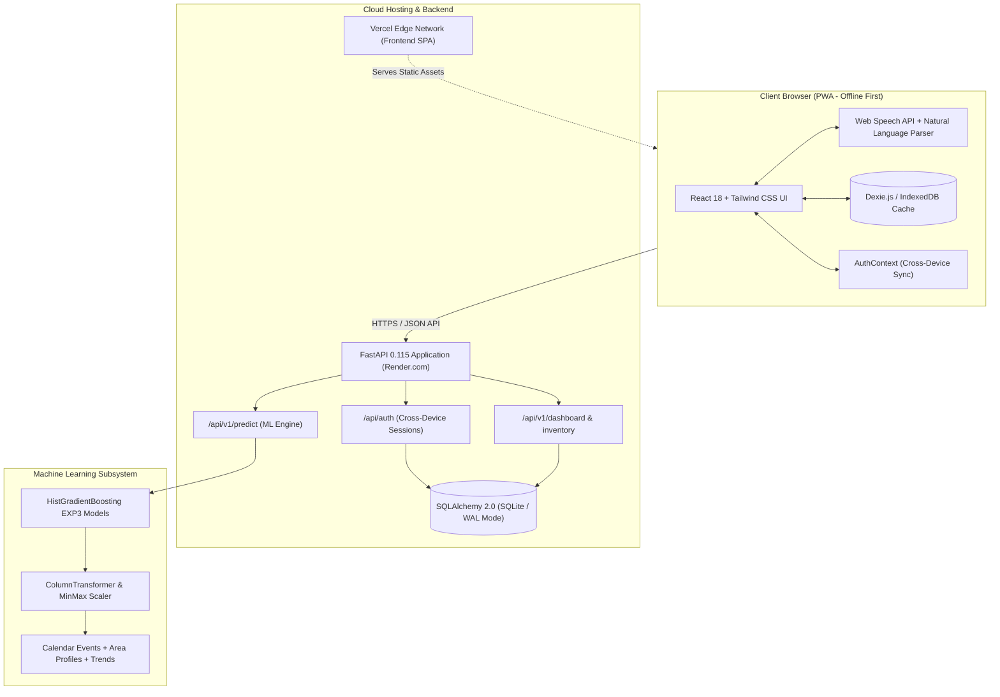
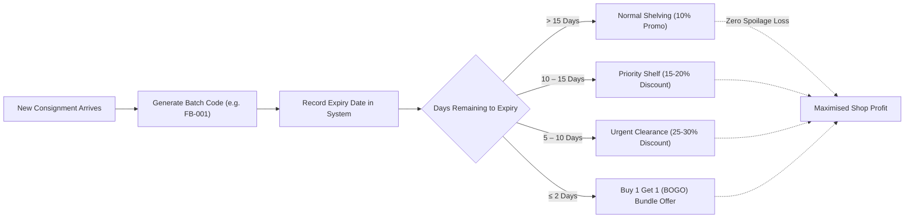

<p align="center">
  
</p>

<h1 align="center">হালখাতা (Haalkhata)</h1>
<h3 align="center">AI-Powered Smart Digital Ledger & Grocery Retail Operating System</h3>

<p align="center">
  <em>ঐতিহ্যবাহী কাগজের খাতা থেকে আধুনিক এআই চালিত সুপারশপ ও মুদি দোকান ব্যবস্থাপনা</em>
</p>

<p align="center">
  <a href="https://github.com/Synity-Soft/Hat-Bazar/actions"></a>
  <a href="https://haalkhata-vjfs.onrender.com/docs"></a>
  <a href="https://react.dev/"></a>
  <a href="https://www.typescriptlang.org/"></a>
  <a href="https://scikit-learn.org/"></a>
  <a href="#license"></a>
</p>

<p align="center">
  <a href="#-key-features">Core Features</a> •
  <a href="#-system-architecture">Architecture</a> •
  <a href="#-fefo--expiry-strategy">FEFO Clearance Flow</a> •
  <a href="#-technology-stack">Tech Stack</a> •
  <a href="#-getting-started">Getting Started</a> •
  <a href="#-api-documentation">API Docs</a>
</p>

---

## 📖 Overview

**হালখাতা (Haalkhata)** is a resilient, offline-first Retail Operating System and AI-powered Digital Ledger engineered specifically for Bangladesh's 1.5M+ neighborhood grocers (মুদি দোকানি). 

Traditional grocery retail in South Asia suffers from **12–18% gross margin loss** due to unmonitored product expiry, **15–20% uncollected credit debts** from fragile paper notebooks, and frequent stockouts caused by guesswork purchasing. 

**হালখাতা** bridges this gap by combining the speed and familiarity of traditional Bengali shopkeeping with cutting-edge **Machine Learning demand forecasting**, **bilingual natural language voice bookkeeping**, **automated FEFO expiry discount liquidation**, and **direct FMCG distributor connectivity**.

---

## 🌟 Key Highlights

| Feature | Traditional Grocery | হালখাতা (Haalkhata) |
| :--- | :--- | :--- |
| **Connectivity** | Freezes during load-shedding / internet drop | **100% Offline-First (Dexie IndexedDB)** Instant local writes |
| **Bookkeeping** | Hand-written paper khatas prone to damage | **Voice AI Bookkeeping** (Bangla & English spoken entries) |
| **Customer Credit** | Forgotten dues & awkward verbal requests | **Automated SMS Reminders** with 1-click repayments |
| **Product Expiry** | Expired stock dumped as total financial loss | **FEFO Batch Codes & Auto-escalating Discounts (up to BOGO)** |
| **Restocking** | Manual guesswork & supplier overcharging | **7D/30D ML Forecasting + Wholesale Price Comparison** |
| **Emergency Stock** | Turning customers away when out of stock | **Neighborhood Shop Network** (Peer borrowing & overstock trade) |

---

## 🚀 Core Features (সেকশন ৪.১ - ৪.১১)

### 🎙️ 1. Bangla & English AI Voice Bookkeeping (Section 4.1)
- **Natural Language Voice Recognition:** Spoken entries in natural colloquial Bengali or English are parsed instantly into structured ledger rows.
  - *Example Spoken Input:* `"আজকে ১৫ হাজার টাকার বিক্রি হয়েছে। ৫ হাজার ক্যাশ, ১০ হাজার বাকি।"`
  - *Extracted Data:* Total Sales: `৳15,000`, Cash In: `৳5,000`, Customer Credit: `৳10,000`.
- **Pre-save Confirmation Modal:** Visual breakdown to verify or edit numbers before committing to the digital ledger.
- **Offline Voice History & Rollback:** Complete transaction history with one-tap corrections.

### 📒 2. Smart Digital Ledger & Khata Management (Section 4.2)
- **Customer Credit Khata (বাকির খাতা):** Customer-wise balances, repayment history, partial payments, and overdue alerts.
- **Supplier & Mahajan Khata (মহাজন খাতা):** Tracks payables to FMCG distributors (Meghna/Fresh, Akij, City Group).
- **Daily Cash Book (ক্যাশ বুক ও খরচ):** Real-time monitoring of Cash-In, Cash-Out, daily shop expenses (rent, electricity, labor), and net drawer cash.
- **Customer Statement:** Single-page financial summary of total purchases, repayments, and outstanding balances.

### 📦 3. AI Batch Recognition & FEFO Expiry Management (Section 4.3)
- **Granular Batch Identity:** Individual codes for every incoming consignment (e.g., Fresh Bun: Batch 1 `FB-001`, Batch 2 `FB-002`).
- **FEFO (First Expired, First Out) Scheduling:** Automatically prompts retailers to release and shelf older batches first.
- **Dynamic Loss-Prevention Discount Schedule:**
  - 🟢 **> 15 Days to Expiry:** 10% promotional discount
  - 🟡 **10 – 15 Days to Expiry:** 15% – 20% clearance discount
  - 🟠 **5 – 10 Days to Expiry:** 25% – 30% markdown
  - 🔴 **≤ 2 Days to Expiry:** Buy 1 Get 1 Free (BOGO) / Clearance bundle to eliminate 100% wastage loss.

### 🤖 4. AI Business Copilot (Section 4.4)
- Interactive conversational assistant (`/assistant`) with 7 one-tap analytical quick-chips in Bengali and English:
  1. *আজকে দোকানে কত টাকার বিক্রি হলো?* (Today's sales & cash breakdown)
  2. *গত এক সপ্তাহে সবচেয়ে বেশি বিক্রি হওয়া ৫টি পণ্য কোনটি?* (Top 5 fast-moving items)
  3. *কোন কাস্টমারের কাছে সবচেয়ে বেশি টাকা বাকি আছে?* (Highest outstanding debtors)
  4. *আগামী ৭ দিনে কোন কোন পণ্য নতুন করে কিনতে হবে?* (Critical 7-day restocking list)
  5. *কোন কোন পণ্যের মেয়াদ দ্রুত শেষ হয়ে যাচ্ছে এবং কত ছাড় দেওয়া উচিত?* (Expiry liquidation recommendations)
  6. *দোকানে কোন পণ্যের অতিরিক্ত স্টক জমে আছে এবং কীভাবে তা কমানো যায়?* (Overstock analysis)
  7. *আসন্ন ঈদের জন্য কোন কোন পণ্য আগে থেকে বেশি করে রাখা দরকার?* (Pre-festival preparation)

### 📈 5. Machine Learning Demand Forecasting (Sections 4.5 & 4.8)
- **HistGradientBoosting Regressor (EXP3 Model):** Forecasts 7-day and 30-day product demand calibrated across residential, student, and garment-worker demographics.
- **Distributor Connector:** Direct one-click order placement via **WhatsApp** and direct phone calls to verified FMCG distributors.

### 🎪 6. Festival-Based Demand Forecasting (Section 4.6)
- Built-in 2026–2027 Bangladeshi national festival calendar (Eid-ul-Fitr, Eid-ul-Adha, Ramadan, Durga Puja, Pohela Boishakh).
- Product-specific surge recommendations (e.g., Semai, Sugar, Soybean Oil, Aromatic Rice for Eid; Chickpeas, Dates, Tang for Ramadan).

### 📲 7. Automated SMS Customer Reminders (Section 4.7)
- Instant polite and urgent Bengali SMS reminder generation with customer balance and due date.
- One-click native messaging launcher (`sms:+8801...`) and bulk reminder action for all overdue debtors.

### ⚖️ 8. Distributor Price & Margin Comparison (Section 4.9)
- Real-time wholesale comparison comparing distributor wholesale rates against maximum retail price (MRP).
- Highlights distributor profit margins (%) and marks the "Best Deal" for shopkeepers.

### 🏪 9. Local Grocery Shop Network & Stock Sharing (Section 4.10)
- Connects clustered neighborhood grocers (e.g., Dhanmondi cluster).
- Allows shopkeepers to broadcast overstock items to neighbors at discounted wholesale rates.
- Enables emergency stock borrowing when a customer requests an out-of-stock product.

### 📊 10. Centralized Business Performance Dashboard (Section 4.11)
- 6 Real-time KPI summary cards: Total Sales, Cash Received, Shop Expenses, Estimated Gross Profit, Total Credit Receivables, and Stock/Expiry Warnings.
- Visual 7-day sales bar chart and staple stock meters (Rice, Dal, Oil).
- Ticking live clock with dynamic morning/afternoon/night SVG skybox.

---

## 🏗️ System Architecture



---

## 🏷️ FEFO & Expiry Strategy



---

## 💻 Technology Stack

| Layer | Technologies |
| :--- | :--- |
| **Frontend Framework** | [React 18](https://react.dev/), [Vite 5](https://vitejs.dev/), [TypeScript 5](https://www.typescriptlang.org/) |
| **Styling & UI** | [Tailwind CSS 3](https://tailwindcss.com/), [Lucide React](https://lucide.dev/), [Framer Motion](https://www.framer.com/motion) |
| **Client Database** | [Dexie.js 4](https://dexie.org/) (IndexedDB wrapper with offline reactive hooks) |
| **Data Visualization** | [Recharts 2](https://recharts.org/) |
| **Backend Framework** | [FastAPI](https://fastapi.tiangolo.com/), [Uvicorn](https://www.uvicorn.org/), [Pydantic v2](https://docs.pydantic.dev/) |
| **ORM & Database** | [SQLAlchemy 2.0](https://www.sqlalchemy.org/), SQLite3 (WAL Journal Mode) |
| **Machine Learning** | [Scikit-learn 1.5.1](https://scikit-learn.org/), [Pandas 2.2](https://pandas.pydata.org/), [NumPy](https://numpy.org/), [Joblib](https://joblib.readthedocs.io/) |
| **Deployment** | [Vercel](https://vercel.com/) (Frontend), [Render.com](https://render.com/) (Backend Web Service) |

---

## 📁 Repository Structure

```text
Hat-Bazar/
├── Frontend/                 # React 18 + Vite + TypeScript PWA Client
│   ├── src/
│   │   ├── components/       # Modular UI components (VoiceModal, POS, Motion)
│   │   ├── context/          # AuthContext & ThemeProvider
│   │   ├── db/               # Dexie.js IndexedDB schema & hooks
│   │   ├── engines/          # Expiry (FEFO), Credit, Festival & Purchase engines
│   │   ├── pages/            # Dashboard, Credit, Expiry, Purchase, Network, Festivals
│   │   ├── lib/              # API client, Bengali typography (bn.ts), utilities
│   │   └── types/            # Shared TypeScript domain contracts
│   ├── public/               # Logos, manifests, and PWA assets
│   ├── vercel.json           # Client-side SPA rewrites
│   └── package.json
│
├── backend/                  # FastAPI Unified Backend
│   ├── database.py           # SQLAlchemy 2.0 engine, WAL pragma & session factory
│   ├── models.py             # Relational domain models (User, Outlet, Product, Batch, Sale)
│   ├── main.py               # Application entrypoint & CORS middleware
│   ├── routers/              # Modular routers (auth, predictions, inventory, expiry, dashboard)
│   └── scripts/              # Seed scripts from synthetic retail data
│
├── ml/                       # Machine Learning Subsystem
│   ├── inference/            # PredictionService singleton for 7D/30D forecasting
│   ├── models/               # Serialized HistGradientBoosting joblib models
│   └── requirements.txt      # Python dependencies
│
├── DataSets/                 # Synthesized retail datasets for Bangladesh FMCG
├── docs/                     # Documentation, presentation slides, and logos
├── vercel.json               # Root fallback configuration for Vercel
├── requirements.txt          # Python deployment requirements
└── README.md                 # Project README
```

---

## ⚡ Getting Started (Local Development)

### Prerequisites
- **Node.js** (v18 or higher)
- **Python** (v3.11.x recommended)
- **Git**

### 1. Clone Repository
```bash
git clone https://github.com/Synity-Soft/Hat-Bazar.git
cd Hat-Bazar
```

### 2. Backend Setup
```bash
# Create and activate Python virtual environment
python3 -m venv .venv
source .venv/bin/activate    # On Windows: .venv\Scripts\activate

# Install dependencies
pip install -r requirements.txt

# Start FastAPI development server
python3 -m uvicorn backend.main:app --host 127.0.0.1 --port 8000 --reload
```
*Backend API will be running at [http://127.0.0.1:8000](http://127.0.0.1:8000), with interactive Swagger documentation at [http://127.0.0.1:8000/docs](http://127.0.0.1:8000/docs).*

### 3. Frontend Setup
```bash
# Open a new terminal tab and enter Frontend directory
cd Frontend

# Install node dependencies
npm install

# Start Vite development server
npm run dev
```
*Frontend will launch at [http://localhost:5173/](http://localhost:5173/).*

---

## 🌐 Cloud Deployment

### 1. Deploying Frontend to Vercel
1. Import repository on [Vercel](https://vercel.com/).
2. Set **Root Directory** to `Frontend`.
3. Set **Framework Preset** to `Vite`.
4. Add Environment Variable:
   - `VITE_API_BASE_URL` = `https://your-backend-service.onrender.com`
5. Click **Deploy**.

### 2. Deploying Backend to Render.com
1. Create a new **Web Service** on [Render.com](https://render.com/).
2. Connect this repository.
3. Configure the service:
   - **Environment:** `Python 3`
   - **Build Command:** `pip install -r requirements.txt`
   - **Start Command:** `uvicorn backend.main:app --host 0.0.0.0 --port $PORT`
4. Click **Deploy Web Service**.

---

## 📡 API Documentation Preview

| Method | Endpoint | Description |
| :--- | :--- | :--- |
| `GET` | `/` | API Root and System Metadata |
| `GET` | `/api/health` | System Health Check (Database & ML status) |
| `POST` | `/api/auth/register` | Centralized User Registration |
| `POST` | `/api/auth/login` | Cross-Device User Authentication |
| `GET` | `/api/shops` | Registered Retail Outlets Directory |
| `POST` | `/api/v1/predict` | 7-Day & 30-Day ML Demand Forecast |
| `GET` | `/api/v1/outlets/{id}/inventory` | Batch Inventory with Expiry Status |
| `GET` | `/api/v1/expiry/batches` | High-Risk Batches Approaching Expiry |
| `GET` | `/api/v1/dashboard/summary` | Consolidated Retail Analytics & KPIs |

---

## 👥 Authors & Acknowledgments

- **Developed by:** Synity Soft Team
- **Event:** International Ai Builders Congress / Capstone Presentation
- **Theme:** Transforming informal retail through resilient offline-first AI architecture.

---

<p align="center">
  <sub>Made with ❤️ for Bangladeshi Grocery Retailers (মুদি দোকানিদের জন্য উৎসর্গীকৃত)</sub>
</p>
