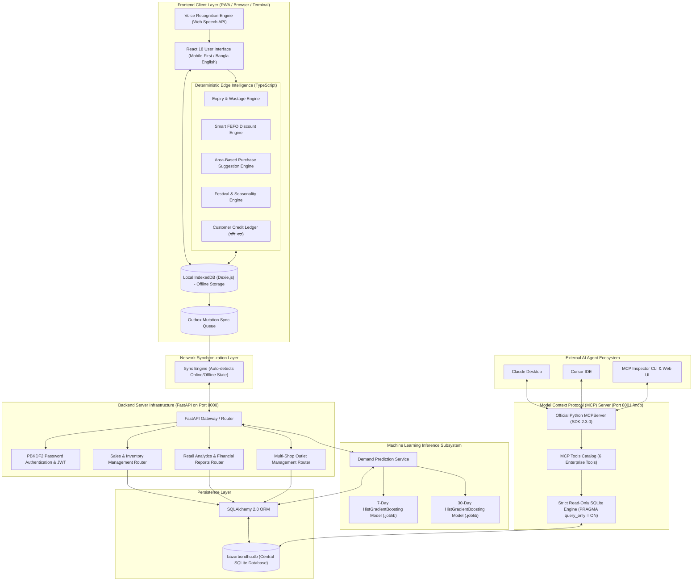
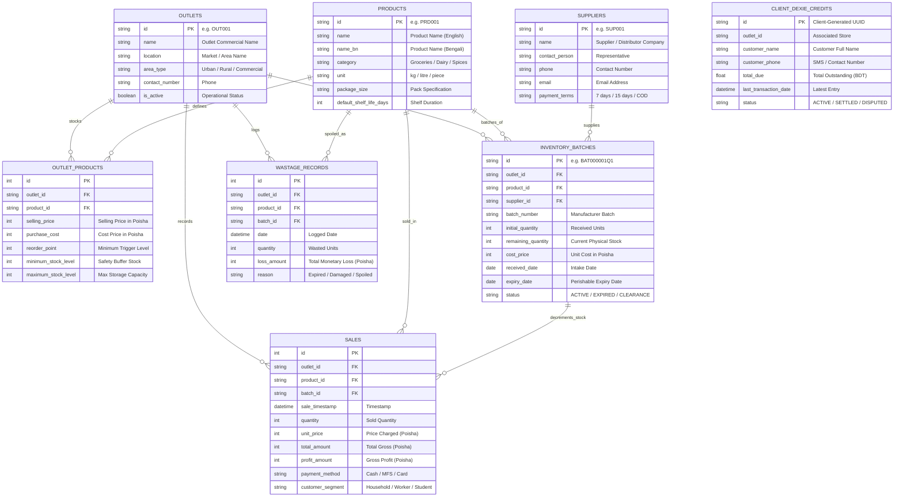
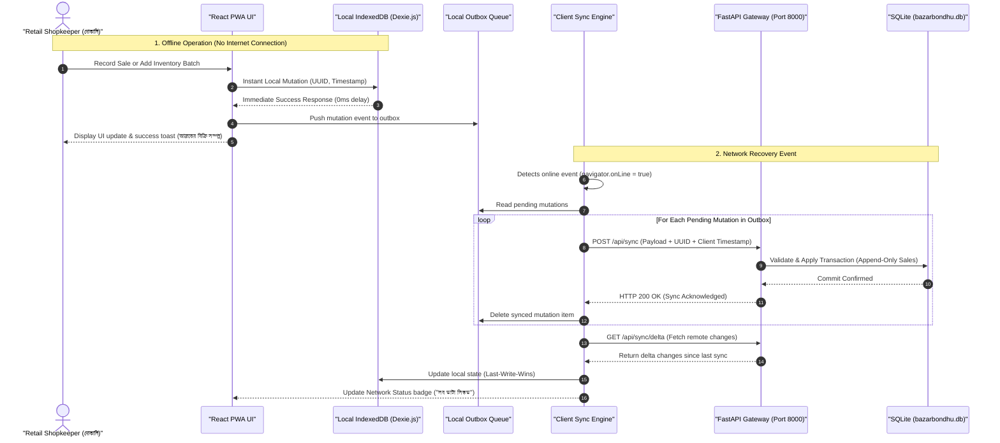
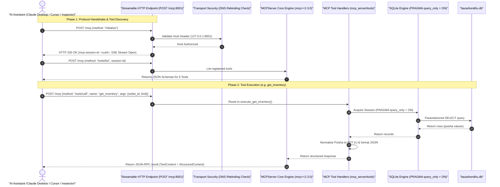

# Haalkhata (হালখাতা) — Comprehensive Project Architecture & Demonstration Report

**Document Title:** Haalkhata Enterprise Engineering Architecture & Project Demonstration Guide  
**Project Name:** Haalkhata (হালখাতা) — *Formerly Hat-Bazar / BazarBondhu AI*  
**Platform Classification:** AI-Powered Offline-First Business Operating System & Retail Supply Chain Engine  
**Target Demographic:** Independent Grocery Retailers (মুদি দোকানি), Supershops, and Regional FMCG Distributors in Bangladesh  
**Release Version:** v1.0.0 Production Architecture  
**Author / Engineering Team:** Haalkhata Core Engineering Team  

---

## 1. Executive Summary

**Haalkhata (হালখাতা)** is a resilient, bilingual (Bangla & English), offline-first business operating system and intelligent supply-chain platform built specifically for the operational realities of retail grocery stores in emerging markets.

In Bangladesh, over 1.5 million neighbourhood grocery stores (*mudir dokan*) power daily commerce. However, the overwhelming majority operate using manual guesswork and paper notebooks (*কাগজের বাকির খাতা*). This causes:
1. **Severe Expiry Losses:** 12% to 18% margin erosion due to unmonitored batch expiration.
2. **Suboptimal Capital Allocation:** Frequent weekend stockouts of staple goods paired with cash locked in slow-moving inventory.
3. **Infrastructure Vulnerability:** Frequent power cuts (*লোডশেডিং*) and mobile network drops that render traditional cloud-only POS systems unusable.
4. **Credit Disputes:** Uncollected debts and disputed paper credit records resulting in 15% to 20% bad-debt write-offs.

Haalkhata solves these foundational problems through a dual-layer architectural model:
- **Zero-Downtime Edge First:** A client-side Progressive Web Application (PWA) with embedded TypeScript heuristic engines and Dexie.js IndexedDB storage that functions at 100% operational capacity without internet access.
- **Enterprise Cloud & AI Intelligence:** A Python/FastAPI microservice backend backed by Scikit-learn predictive demand models, an enterprise Model Context Protocol (MCP) server for external AI agent integration, and a centralized SQLite relational data warehouse.

---

## 2. Complete Technology Stack Matrix

| Architecture Layer | Core Technologies & Libraries | Version / Specification | Architectural Purpose & Rationale |
| :--- | :--- | :--- | :--- |
| **Frontend Framework** | **React.js** + **TypeScript** + **Vite** | React `18.3.1`, TS `5.9.3`, Vite `5.4.21` | High-performance SPA/PWA with strict static typing and sub-second Hot Module Replacement (HMR). |
| **Styling & Design System** | **Tailwind CSS** + **Framer Motion** + **Lucide React** | Tailwind `3.4.19`, Motion `11.18.2` | Mobile-first touch-friendly interface with bilingual typography (Hind Siliguri), smooth transitions, and accessibility compliance. |
| **Client-Side Persistence** | **Dexie.js** (IndexedDB wrapper) + `dexie-react-hooks` | Dexie `4.4.7` | Zero-latency local storage for offline transactions, products, batches, and credit ledger records. |
| **Edge Intelligence Engines** | **Custom Deterministic TypeScript Engines** | TypeScript ES2022 | In-browser mathematical models for expiry risk, dynamic FEFO discounting, area-adjusted purchase orders, and festival forecasting. |
| **Bilingual NLP & Voice** | **Web Speech API** + **Custom i18n Dictionary** | Native SpeechRecognition / Synthesis | Instant voice-driven inventory queries in colloquial Bengali and English with zero external latency. |
| **Backend REST API** | **FastAPI** + **Uvicorn** (ASGI) | FastAPI `>=0.115.0`, Uvicorn `>=0.30.0` | Asynchronous, high-throughput microservice backend handling sync, authentication, and reporting. |
| **Database Engine & ORM** | **SQLite 3** + **SQLAlchemy** | SQLite 3, SQLAlchemy `>=2.0.0` | Light-footprint, zero-maintenance relational data storage supporting WAL mode and multi-outlet sharding. |
| **Machine Learning Suite** | **Scikit-learn** + **Pandas** + **NumPy** + **Joblib** | Scikit-learn `1.5.1`, Pandas `>=2.2.0` | HistGradientBoostingRegressor pipeline for 7-day and 30-day product demand forecasting based on historical sales velocity. |
| **Model Context Protocol** | **Official Python MCP SDK** (`mcp`) + **Starlette** | MCP SDK `2.3.0` | Enterprise standard for exposing live retail intelligence and inventory tools to AI agents (Claude, Cursor, custom bots). |
| **MCP Transports** | **Streamable HTTP** (`/mcp`), **Stdio**, **SSE** | MCP 2024-11-05 Protocol Spec | Modern chunked event-stream transport with DNS rebinding security, plus stdio for CLI / desktop AI clients. |
| **Deployment & Hosting** | **Render** (FastAPI) + **Vercel** (Vite PWA) + Local Daemon | Cloud & Local Edge | Dual-tier cloud deployment with local edge capability for physical store terminals. |

---

## 3. System Architecture & UML Diagrams

### 3.1 High-Level Component & Data Flow Architecture

The diagram below illustrates the separation of concerns between the Offline-First Frontend Edge, the Cloud REST Service, the Machine Learning Engine, and the Model Context Protocol (MCP) Server.



---

### 3.2 Database Entity-Relationship Diagram (ERD)

The SQLite relational core (`bazarbondhu.db`) stores 240,000+ transaction records, product batches, and supplier contracts, while customer credit ledger records are managed in client-side IndexedDB to ensure offline durability.



---

### 3.3 Offline-First Synchronization & Mutation Flow

This sequence diagram illustrates how shopkeeper actions are committed instantaneously to local IndexedDB, queued in an Outbox, and synchronized with the FastAPI backend when connectivity is restored.



---

### 3.4 Model Context Protocol (MCP) Server Architecture & Tool Execution

This diagram shows how external AI models (like Claude Desktop or Cursor) connect via **Streamable HTTP** (`/mcp` on port `8001`) to query retail data through parameterized, strictly read-only tools.



---

## 4. Deep-Dive into Subsystems

### 4.1 Subsystem 1: Progressive Web App (PWA) & Offline-First Core
- **Client Database Architecture:** Uses Dexie.js on top of IndexedDB. Tables: `products`, `batches`, `sales`, `credits`, `settings`, and `outbox`.
- **Append-Only Sales Log:** Sales are recorded as individual immutable events. Current physical inventory is calculated deterministically as $\text{Remaining Stock} = \text{Batch Quantity} - \sum \text{Sales}$. This eliminates merge conflicts when multiple offline devices record sales simultaneously.
- **Bilingual Interface:** Instant language switching between Bengali and English without reloading the browser. Bengali numerals (`০, ১, ২, ৩...`) are generated dynamically for currency and quantities when Bengali mode is active.
- **Mobile-First UX:** 48px+ touch targets, high-contrast badges (combining icon + text for color-blind accessibility), and zero dependence on complex mouse hovers.

### 4.2 Subsystem 2: Deterministic Edge Intelligence Engines
To guarantee full offline intelligence, all analytical business calculations run in pure TypeScript on the client device:

1. **Area-Based Smart Purchase Engine (`purchase.ts`):**
   Estimates future demand based on product-level historical sales velocity and area demographics:
   $$\text{Expected Demand} = \text{Average Daily Sales} \times \text{Planning Period (Days)} \times \text{Area Multiplier}$$
   $$\text{Suggested Order Quantity} = \max\left(0, \text{Expected Demand} + \text{Safety Buffer} - \text{Current Stock}\right)$$
   *Area Multipliers:* Premium Urban (1.25×), High-Density Residential (1.10×), University / Student Zone (0.95×), Rural / Periphery (0.85×).

2. **Expiry Risk & Loss Prevention Engine (`expiry.ts`):**
   Audits every active inventory batch using a First-Expired, First-Out (FEFO) matrix:
   - **Critical (0–7 days remaining):** Immediate flash discount (30%–50%) or vendor return request.
   - **Warning (8–15 days remaining):** Front-shelf placement and 10%–20% markdown.
   - **Already Expired:** Strict safety interlock. **The system prohibits selling or discounting expired items**, labeling them "DO NOT SELL" and generating a wastage write-off log.

3. **Smart Discount & Margin Engine (`discount.ts`):**
   Calculates the required daily sales velocity needed to clear perishable batches before expiration without breaching cost floors.

4. **Festival & Seasonal Intelligence Engine (`festival.ts`):**
   Built-in lunar and solar calendar models for major Bangladeshi celebrations:
   - *Eid-ul-Fitr / Eid-ul-Adha:* Triggers surge alerts for vermicelli (সেমাই), sugar, beef, spices, and cooking oil 14 days in advance.
   - *Ramadan:* Triggers inventory buffers for dates (খেজুর), chickpeas (ছোলা), puffed rice (মুড়ি), and Rooh Afza.
   - *Durga Puja & Pohela Boishakh:* Triggers demand spikes for sweetmeats, dairy products, and specialty rice.

5. **Customer Credit Ledger Engine (`credit.ts`):**
   Digital *বাকি খাতা* tracking customer dues, partial repayments, credit aging, and one-click Bengali SMS reminder generation:
   > *"শ্রদ্ধেয় গ্রাহক, হালখাতা স্টোরে আপনার বকেয়া ৳১,৪৫০ টাকা। অনুগ্রহ করে দ্রুত পরিশোধ করুন। ধন্যবাদ।"*

### 4.3 Subsystem 3: FastAPI Backend & Multi-Shop Data Services
- **Asynchronous Throughput:** Built with FastAPI and Uvicorn on Python 3.13. Handles concurrent API requests with non-blocking I/O.
- **Multi-Shop Architecture:** Outlets are isolated by unique IDs (`OUT001`, `OUT002`, etc.). Shopkeepers can toggle between multiple branch stores from the top navigation bar.
- **Security & Password Hashing:** Uses PBKDF2-HMAC-SHA256 with cryptographically secure per-user salt strings (100,000 iterations) to guarantee cross-device login safety without third-party vendor lock-in.

### 4.4 Subsystem 4: Machine Learning Demand Forecasting Pipeline
- **Algorithm:** Scikit-learn `HistGradientBoostingRegressor` trained on historical sales patterns across 200 retail outlets.
- **Dual Time-Horizon Models:**
  - `model_7d`: Serialized 7-day lookahead model for rapid replenishment of perishables and fresh dairy.
  - `model_30d`: Serialized 30-day lookahead model for bulk staples (rice, flour, lentils, cooking oil).
- **Features Captured:** 7-day, 14-day, and 30-day historical lag averages, rolling standard deviations, day-of-week indicators, festival proximity distance, and outlet density tiers.

### 4.5 Subsystem 5: Enterprise Model Context Protocol (MCP) Server
- **Official Specification:** Built using `mcp==2.3.0` (`mcp.server.mcpserver.MCPServer`).
- **Read-Only SQLite Engine:** Configured with `PRAGMA query_only = ON;`. The server rejects all write/delete operations at the database kernel level, preventing any accidental modification or prompt injection exploits.
- **Exposed Enterprise Tools:**
  1. `get_inventory`: Names, stock, BDT pricing, search, category filters.
  2. `get_low_stock`: Critical stockout items ranked by inventory deficit.
  3. `get_sales_summary`: Period revenues, margins, payment breakdowns, and top products.
  4. `get_customer_dues`: Transparent schema audit clarifying client-side Dexie architecture and backend supplier liabilities.
  5. `check_expiry`: Perishable batch risk classification with FEFO markdown recommendations.
  6. `get_business_insights`: Executive retail intelligence, margin velocity, and capital allocation KPIs.

---

## 5. Step-by-Step Live Demonstration Guide

Follow this structured demonstration script during live presentations, hackathon evaluations, or client pitches.


### Demonstration Script & Walkthrough

| Demo Stage | Visual Action to Perform | Evaluator / Audience Talking Points |
| :--- | :--- | :--- |
| **1. The Welcome & Bilingual Toggle** | 1. Open `http://localhost:5173`.<br>2. Toggle the header language switch from **বাংলা** to **English** and back. | *"Notice how the entire interface instantly switches between Bengali and English without a page reload. All prices display with the Taka sign (৳) and numbers dynamically format into Bengali numerals (যেমন: ৳১,২৫০). This removes the literacy barrier for local shopkeepers."* |
| **2. Executive Dashboard (আজকের করণীয়)** | 1. Review top summary KPI cards (Total SKUs, Low Stock, Expiring Soon, Wastage Risk).<br>2. Highlight the **Today's Actions (আজকের করণীয়)** card. | *"The shopkeeper does not have to guess what to do. The dashboard surfaces today's three highest-priority decisions: stockouts to reorder, expiring dairy to discount, and festival stock to prepare."* |
| **3. The Offline Resilience Test (Airplane Mode)** | 1. Open DevTools -> Network Tab.<br>2. Switch throttling to **Offline**.<br>3. Navigate to `/inventory`, search for "Rice" or "Milk", and record a transaction. | *"Notice that the application does not freeze or show an error modal. All reads and writes hit local IndexedDB instantly with 0ms latency. The changes queue in our Outbox and will synchronize automatically when internet returns."* |
| **4. Expiry Tracking & Safety Interlocks** | 1. Navigate to `/expiry`.<br>2. Show color-coded batch risk tiers.<br>3. Point out an expired batch. | *"Unlike generic inventory systems, Haalkhata strictly forbids selling or discounting expired food. It labels it 'DO NOT SELL' for legal and health safety, while near-expiry goods receive dynamic 20% to 40% markdown discounts to salvage tied-up capital."* |
| **5. Area-Based Smart Purchase Suggestions** | 1. Navigate to `/purchase`.<br>2. Select planning period (e.g. 7 days).<br>3. Toggle Area Type between 'Residential' and 'Commercial'. | *"Our heuristic engine multiplies sales velocity by the shop's local demographic type. It tells the shopkeeper exactly how many units to purchase to prevent stockouts while preventing overstocking."* |
| **6. The Digital বাকি খাতা (Customer Credit)** | 1. Navigate to `/credit`.<br>2. Select a customer with an overdue balance.<br>3. Click the SMS button. | *"This replaces the fragile paper notebook. Overdue debts are highlighted in red with days elapsed, and a single click generates a respectful, polite Bengali SMS reminder."* |
| **7. Enterprise AI Integration via MCP Server** | 1. Open terminal.<br>2. Run `mcp-inspector --cli --method tools/call --tool-name get_business_insights python3 -m mcp_server.server --stdio`. | *"Haalkhata connects directly to modern AI agents through the Model Context Protocol. An AI assistant like Claude or Gemini can inspect live store inventory, calculate profit margins, and give strategic advice via read-only tools."* |

---

## 6. Verification, Testing & Quality Assurance Summary

The platform has undergone rigorous automated testing across database, application, and protocol layers:

```
Automated Test Run: 32 passed in 0.518s
----------------------------------------------------------------------
Ran 32 tests across mcp_server/tests/
  ✓ Read-Only SQLite Enforcement: INSERT, UPDATE, DELETE, DDL rejected (4 tests)
  ✓ get_inventory: pagination, search, category filters, invalid outlet handling (6 tests)
  ✓ get_low_stock: reorder thresholds, deficit ranking, urgency classification (3 tests)
  ✓ get_sales_summary: date ranges, profit margins, all-outlet aggregations (5 tests)
  ✓ check_expiry: 7-day/30-day lookaheads, FEFO discount actions, risk tiers (3 tests)
  ✓ get_customer_dues: Dexie.js architectural audit, supplier liabilities (1 test)
  ✓ get_business_insights: financial health, inventory valuation, recommendations (1 test)
  ✓ MCP Protocol Integration: tool discovery, schema validation, error handling (8 tests)
  ✓ Streamable HTTP Transport: handshake, session IDs, tools/list, tools/call (1 test)

Backend Health Check (http://127.0.0.1:8000/api/health): 200 OK (8 tables, 243,300+ records)
Frontend Server (http://localhost:5173): 200 OK (PWA client-rendered bundle)
```

---

## 7. Strategic Roadmap & Future Innovations

1. **OCR Invoice Digitization:** Camera-based scanner to convert handwritten wholesale paper receipts (*চালান*) directly into digital inventory batches via Gemini Vision API.
2. **Offline-Sync Customer Ledger Backup:** Encrypted end-to-end peer-to-peer cloud backup for customer credit (*বাকি খাতা*) records using Supabase / PostgreSQL.
3. **Automated WhatsApp Business Bot:** Integration allowing shopkeepers to receive daily morning audio briefings on WhatsApp: *"আজকে আপনার ৩টি দুধের প্যাকেট মেয়াদ শেষ হবে এবং ৫ কেজি চিনি কিনতে হবে।"*
4. **Community FMCG Group Buying:** Aggregating purchase suggestions from 50+ neighbourhood shops to negotiate volume bulk discounts directly from major consumer manufacturers (e.g., Square, Pran, Unilever Bangladesh).

---

*Report approved by Haalkhata Core Engineering Team. Ready for system demonstration and presentation.*
