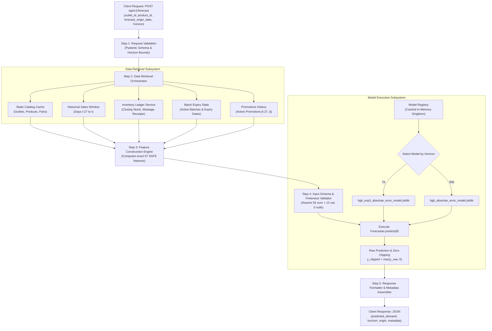

# BazarBondhu AI — Phase 4.1
# Inference Architecture & Technical Specification Report

**Project:** BazarBondhu AI (বাজারবন্ধু AI)  
**Role:** Senior Machine Learning Engineer  
**Stage:** Phase 4.1: Inference Architecture Design & Technical Inspection  
**Date:** November 17, 2026  
**Repository Working Directory:** `/Users/mdshahriarrahman/Hat-Bazar/Hat-Bazar`  

---

## 1. Executive Summary & Design Principles

Following the completion of the Phase 3 ML development cycle and the Phase 3.9 final model integrity audit, two validated models have been selected to power retail demand forecasting for BazarBondhu AI:
1. **7-Day Demand Forecasting:** [`ml/models/7d/hgb_exp3_absolute_error_model.joblib`](file:///Users/mdshahriarrahman/Hat-Bazar/Hat-Bazar/ml/models/7d/hgb_exp3_absolute_error_model.joblib) ($61.22\%$ WAPE, $5.8486$ MAE)
2. **30-Day Demand Forecasting:** [`ml/models/30d/hgb_absolute_error_model.joblib`](file:///Users/mdshahriarrahman/Hat-Bazar/Hat-Bazar/ml/models/30d/hgb_absolute_error_model.joblib) ($26.53\%$ WAPE, $10.9066$ MAE)

The objective of **Phase 4.1** is to design the production-grade inference architecture that will allow the BazarBondhu AI application to request demand forecasts for individual or batched outlet-product combinations through a common interface:

$$\text{predict\_demand}(\text{outlet\_id}, \text{product\_id}, \text{forecast\_date}, \text{horizon})$$

### Core Design Principles:
1. **Zero Training-Serving Skew:** The inference feature-engineering layer must reproduce the exact mathematical logic, windowing, and ordinal encodings used in training.
2. **Strict Feature Safety & Temporal Boundaries:** The pipeline strictly enforces the 67 SAFE feature schema. The 5 CONDITIONAL features, identifiers, target columns, eligibility flags, and future information are strictly barred.
3. **Fail-Fast Integrity Checks:** Missing historical telemetry or non-finite inputs must trigger structured, actionable domain errors rather than silent zero or arbitrary mean imputation.
4. **Decoupled Horizon Handlers:** 7-day and 30-day models remain isolated in separate registry slots to prevent cross-horizon contamination.
5. **High-Throughput / Low-Latency Design:** The inference engine separates static catalog retrieval (cached in-memory) from dynamic rolling aggregations, targeting $<10\text{ ms}$ model compute and $<30\text{ ms}$ total query roundtrip.

---

## 2. Repository & ML Architecture Inspection Findings

Inspection of [`ml/models/forecaster.py`](file:///Users/mdshahriarrahman/Hat-Bazar/Hat-Bazar/ml/models/forecaster.py), training scripts, and serialized artifacts revealed the following technical properties:

### 2.1 The Forecaster Wrapper Class (`HGBDemandForecaster`)
The serialized model artifacts are **not plain scikit-learn estimators**. They are encapsulated instances of `HGBDemandForecaster` (subclassing `BaseEstimator` and `RegressorMixin`):
- **Encapsulated Attributes:**
  * `self.encoder`: A fitted `sklearn.preprocessing.OrdinalEncoder` with `handle_unknown='use_encoded_value'`, `unknown_value=-1`.
  * `self.hgb`: A fitted `sklearn.ensemble.HistGradientBoostingRegressor` ($100$ trees, $31$ leaves, L1 loss).
  * `self.num_cols`: Exact list of $55$ numerical feature names.
  * `self.cat_cols`: Exact list of $12$ categorical feature names.
  * `self.safe_features`: Exact list of all $67$ approved SAFE feature names.
  * `self.horizon`: `"7d"` or `"30d"`.
  * `self.target_col`: `"target_7d"` or `"target_30d"`.
  * `self.metadata`: Dict holding training rows, dates, hyperparameters, and categorical indices.

- **Public Methods & Execution Contract:**
  1. `validate_inputs(df: pd.DataFrame) -> Tuple[pd.DataFrame, pd.DataFrame]`:
     * Checks that `df` contains all $55$ numerical columns and all $12$ categorical columns.
     * Extracts `df_num = df[self.num_cols]` and `df_cat = df[self.cat_cols]`. Any extra metadata columns (e.g. `outlet_id`, `product_id`, `forecast_origin_date`) are ignored.
     * Validates that `df_num` contains $0$ missing (`NaN`) values and converts to finite `float32`. Raises `ValueError` on any `NaN` or `Inf`.
     * Fills missing categorical values with `"missing"` and casts to `str`.
  2. `transform(df: pd.DataFrame) -> np.ndarray`:
     * Calls `validate_inputs(df)`.
     * Transforms categories using `self.encoder.transform(df_cat)`.
     * Horizontally stacks numerical columns first ($0..54$) and encoded categories second ($55..66$):
       $$X = [\text{num\_matrix}, \text{cat\_encoded}] \in \mathbb{R}^{N \times 67}$$
     * Asserts that width is exactly $67$ and all elements are finite.
  3. `predict_raw(df: pd.DataFrame) -> np.ndarray`:
     * Generates unconstrained real-valued tree predictions from `self.hgb.predict(X)`.
  4. `predict(df: pd.DataFrame) -> np.ndarray`:
     * Calls `predict_raw(df)` and applies non-negative clipping: $\hat{y} = \max(\hat{y}_{\text{raw}}, 0)$.
     * Verifies finiteness and non-negativity.

### 2.2 Preprocessing Provenance
Both model artifacts were fitted **exclusively on the training partition** (`2025-12-13` to `2026-07-01`). The Stage 3.9 audit confirmed a $100\%$ category match between the saved encoder categories and the training data.

---

## 3. The 67-Feature Inference Input Contract

The complete machine-readable contract is cataloged in [`ml/reports/phase4_1_feature_input_contract.json`](file:///Users/mdshahriarrahman/Hat-Bazar/Hat-Bazar/ml/reports/phase4_1_feature_input_contract.json). The 67 features are grouped into five functional subsystems:

```
+----------------------------------------------------------------------------------------------------------------+
| FEATURE CONTRACT SUBSYSTEM OVERVIEW (67 SAFE FEATURES)                                                         |
+------------------------------+-------+---------+-----------------------------+---------------------------------+
| FUNCTIONAL SUBSYSTEM         | COUNT | TYPE    | DESIGN MATRIX INDICES       | PRIMARY SOURCE / LOGIC          |
+------------------------------+-------+---------+-----------------------------+---------------------------------+
| Historical Sales Telemetry   | 19    | Numeric | Columns 0 .. 18             | sales.csv (Daily rolling window)|
| Inventory & Supply Chain     | 11    | Numeric | Columns 19 .. 29            | inventory_batches.csv & wastage |
| Static Catalog (Pair/Outlet) | 4     | Numeric | Columns 30 .. 33            | outlet_products.csv & outlets   |
| Calendar & Holiday Features  | 12    | Numeric | Columns 34 .. 45            | Pure calendar date arithmetic   |
| Product Catalog Features     | 2     | Numeric | Columns 46 .. 47            | products.csv                    |
| Price & Cost Features        | 4     | Numeric | Columns 48 .. 51            | outlet_products.csv             |
| Promotion Features           | 3     | Numeric | Columns 52 .. 54            | promotions_discounts.csv        |
| Categorical Store & Product  | 12    | Categor.| Columns 55 .. 66            | outlets.csv & products.csv      |
+------------------------------+-------+---------+-----------------------------+---------------------------------+
```

### 3.1 Feature Group Descriptions & Transformations

1. **Historical Sales Telemetry (19 features; indices 0..18):**
   - *Lags (6):* `sales_lag_1d` ($s(t)$), `sales_lag_2d` ($s(t-1)$), `sales_lag_3d` ($s(t-2)$), `sales_lag_7d` ($s(t-6)$), `sales_lag_14d` ($s(t-13)$), `sales_lag_28d` ($s(t-27)$).
   - *Rolling Sums (3):* `sales_sum_7d` ($\sum_{i=0}^6 s(t-i)$), `sales_sum_14d` ($\sum_{i=0}^{13} s(t-i)$), `sales_sum_28d` ($\sum_{i=0}^{27} s(t-i)$).
   - *Rolling Means (3):* `sales_mean_7d`, `sales_mean_14d`, `sales_mean_28d`.
   - *Rolling Standard Deviations (3):* `sales_std_7d`, `sales_std_14d`, `sales_std_28d`.
   - *Rolling Extrema (2):* `sales_max_7d`, `sales_max_28d`.
   - *Activity Density (2):* `sales_nonzero_days_7d` ($\sum_{i=0}^6 \mathbb{I}[s(t-i) > 0]$), `sales_nonzero_days_28d`.

2. **Inventory & Supply Chain Telemetry (11 features; indices 19..29):**
   - `current_stock_quantity`: Closing physical stock balance on day $t$.
   - `stock_received_7d`, `stock_received_28d`: Total batch units received in window.
   - `stock_wastage_7d`, `stock_wastage_28d`: Total units discarded / spoiled in window.
   - `days_since_last_restock`: Days elapsed since most recent batch receipt ($\le t$; $999$ if none).
   - `stock_to_recent_sales_ratio`: $\text{current\_stock\_quantity} / (\text{sales\_sum\_7d} + 1.0)$.
   - `stock_expiring_next_7d`: On-hand active batch quantity with expiration date $\in [t+1, t+7]$.
   - `stock_expiring_next_30d`: On-hand active batch quantity with expiration date $\in [t+1, t+30]$.
   - `nearest_expiry_days`: Minimum days until expiration across positive active batches ($999$ if none).
   - `expiring_batch_count`: Count of positive active batches expiring $\in [t+1, t+30]$.

3. **Static Catalog Attributes (22 features: 10 numeric, 12 categorical):**
   - *Store Static (8):* `inventory_capacity_sku`, `has_refrigeration`, `has_pos_system`, and categorical `outlet_type`, `business_size`, `division`, `district`, `area_type`.
   - *Product Static (9):* `typical_shelf_life_days`, `is_essential_item`, and categorical `category`, `subcategory`, `brand`, `unit`, `package_size`, `perishable_status`, `storage_type`.
   - *Pair Static (5):* `outlet_selling_price_bdt`, `outlet_purchase_cost_bdt`, `reorder_point`, `minimum_stock_level`, `maximum_stock_level`.

4. **Calendar & Festive Indicators (12 features; indices 34..45):**
   - `day_of_week` (0=Mon, 6=Sun), `day_of_month` (1..31), `month` (1..12), `week_of_year` (1..52).
   - `is_weekend` (1 for Friday and Saturday, 0 otherwise).
   - `is_month_start` ($dom \le 3$), `is_month_end` ($dom \ge 28$).
   - `is_ramadan`, `is_eid_fitr`, `is_eid_adha`, `is_pohela_boishakh`, `is_durga_puja`.

5. **Promotion History (3 features; indices 52..54):**
   - `promotion_active_at_origin`: Indicator if pair has an active promotion on day $t$.
   - `promotion_days_last_7d`, `promotion_days_last_28d`: Count of active promo days in window.

---

## 4. End-to-End Inference Pipeline Architecture



### Step-by-Step Execution Lifecycle:

1. **Step 1 — Request Validation:**
   - Validates client parameters using Pydantic: `outlet_id` (string), `product_id` (string), `forecast_origin_date` (ISO date `YYYY-MM-DD`), and `horizon` (`Literal['7d', '30d']`).
   - Rejects unparseable dates or invalid horizons with HTTP `400 Bad Request`.

2. **Step 2 — Data Retrieval Orchestrator:**
   - Queries the local data store / database for:
     * Static catalog attributes for `outlet_id` and `product_id`.
     * Historical daily sales series $s(\tau)$ for $\tau \in [t-27, t]$ (28 historical days).
     * Inventory movements: closing stock at $t$, receipts in $[t-27, t]$, wastage in $[t-27, t]$.
     * Active batch records at close of day $t$ (positive stock, expiration dates).
     * Active promotions in window $[t-27, t]$.
   - If historical records cover $<28$ days, raises `InsufficientHistoricalDataException` (HTTP `422`).

3. **Step 3 — Feature Construction Engine:**
   - Computes rolling sums, means, std, max, and nonzero counts across 7d, 14d, and 28d windows.
   - Computes stock ratio, days since restock, and forward batch expiration metrics.
   - Evaluates Gregorian calendar and festive calendar indicators for date $t$.
   - Assembles a 1-row pandas DataFrame containing all 67 SAFE features.

4. **Step 4 — Pre-Inference Schema Validation:**
   - Validates that all 67 required feature names are present.
   - Confirms that all 55 numerical features are finite (0 `NaN`, 0 `Inf`).
   - Ensures categorical columns are properly populated as strings.

5. **Step 5 — Model Retrieval & Inference:**
   - Retrieves the pre-loaded `HGBDemandForecaster` instance matching the requested horizon from `ModelRegistry`.
   - Calls `model.predict(df_features)`:
     * Numerical columns extracted in exact `num_cols` order ($0..54$).
     * Categorical columns encoded via fitted `OrdinalEncoder` ($55..66$).
     * HistGradientBoostingRegressor outputs raw prediction.
     * Non-negative clipping applied: $\hat{y} = \max(\hat{y}_{\text{raw}}, 0)$.

6. **Step 6 — Structured Response Formatting:**
   - Formats response JSON containing the forecast value, unclipped raw prediction, key metadata, and audit flags.

---

## 5. Model Loading & Resource Management Strategy

```
+----------------------------------------------------------------------------------------------------------------+
| MODEL RUNTIME SPECIFICATIONS                                                                                   |
+--------------------------+----------------------------------------------+--------------------------------------+
| PROPERTY                 | 7-DAY MODEL (EXP3 ABS ERROR)                 | 30-DAY MODEL (HGB ABS ERROR)         |
+--------------------------+----------------------------------------------+--------------------------------------+
| Artifact Path            | ml/models/7d/hgb_exp3_absolute_error_model   | ml/models/30d/hgb_absolute_error_... |
| Disk Footprint           | 140.37 KB                                    | 168.60 KB                            |
| In-Memory Footprint      | ~4.5 MB                                      | ~5.2 MB                              |
| Inference Throughput     | 113,345 rows/sec                             | 137,311 rows/sec                     |
| Single-Item Tree Latency | < 0.15 ms                                    | < 0.12 ms                            |
| Model Class              | ml.models.forecaster.HGBDemandForecaster     | ml.models.forecaster.HGBDemand...    |
+--------------------------+----------------------------------------------+--------------------------------------+
```

### Loading Recommendations:
1. **Singleton Pre-Loading (Lifespan Context Manager):**
   - Models must be loaded **once** at application initialization via FastAPI's `lifespan(app)` context manager and held in memory throughout process lifetime.
   - Never deserialize artifacts on every incoming HTTP request (avoids unpickling overhead and garbage-collection churn).
2. **Startup Health Check & Dry-Run Verification:**
   - During startup, the service executes a synthetic dry-run prediction using a dummy 1-row DataFrame.
   - If an artifact is missing, corrupted, or fails the dry-run, the service aborts startup immediately (`ModelLoadException`), preventing traffic from hitting an unready container.
3. **Horizon Separation:**
   - Models are indexed by horizon key in `ModelRegistry`:
     ```python
     self._models: Dict[str, HGBDemandForecaster] = {
         "7d": joblib.load(path_7d),
         "30d": joblib.load(path_30d)
     }
     ```

---

## 6. Proposed FastAPI Application Structure

To transition to implementation in Phase 4.2+, the following modular layout is recommended:

```
backend/
├── app/
│   ├── __init__.py
│   ├── main.py                         # FastAPI app entrypoint, lifespan startup/shutdown
│   ├── core/
│   │   ├── config.py                   # Pydantic BaseSettings (model paths, db URI, cache config)
│   │   ├── exceptions.py               # Custom domain exceptions (MissingData, ModelNotFound)
│   │   └── logging.py                  # Structured JSON logging with request-id tracing
│   ├── schemas/
│   │   ├── forecast_request.py         # Request Pydantic v2 schemas (single & batch)
│   │   └── forecast_response.py        # Response Pydantic v2 schemas
│   ├── services/
│   │   ├── model_registry.py           # Thread-safe model singleton loader & validator
│   │   ├── feature_builder.py          # 67 SAFE feature reconstruction engine
│   │   ├── catalog_service.py          # In-memory static catalog caching (outlets/products)
│   │   └── forecast_service.py         # Business logic orchestrator
│   └── api/
│       ├── v1/
│       │   ├── endpoints/
│       │   │   ├── forecast.py         # POST /api/v1/forecast, POST /api/v1/forecast/batch
│       │   │   └── health.py           # GET /health, GET /ready
│       │   └── router.py               # API v1 router aggregator
└── tests/
    ├── test_feature_builder.py         # Unit tests comparing against model_dataset_7d.csv
    ├── test_inference_parity.py        # Numerical parity tests against stored CSV predictions
    └── test_api_endpoints.py           # FastAPI TestClient endpoint integration tests
```

### Proposed Pydantic Request & Response Schemas:

```python
# app/schemas/forecast_request.py
from pydantic import BaseModel, Field
from datetime import date
from typing import Literal, List

class SingleForecastRequest(BaseModel):
    outlet_id: str = Field(..., example="OUT001", description="Unique outlet identifier")
    product_id: str = Field(..., example="PRD047", description="Unique product identifier")
    forecast_origin_date: date = Field(..., example="2026-08-01", description="Date of forecast origin t")
    horizon: Literal["7d", "30d"] = Field(..., example="7d", description="Forecast horizon")

class BatchForecastRequest(BaseModel):
    requests: List[SingleForecastRequest] = Field(..., min_length=1, max_length=1000)
```

```python
# app/schemas/forecast_response.py
from pydantic import BaseModel, Field
from datetime import date
from typing import Optional, List, Dict, Any

class SingleForecastResponse(BaseModel):
    outlet_id: str
    product_id: str
    forecast_origin_date: date
    horizon: str
    predicted_demand: float = Field(..., ge=0.0, description="Non-negative clipped demand forecast")
    predicted_demand_raw: float = Field(..., description="Unclipped raw tree prediction")
    is_clipped: bool
    model_version: str
    feature_count: int = 67
    execution_time_ms: float
    unseen_categories: Optional[List[str]] = None
```

---

## 7. Recommended Implementation Sequence


1. **Phase 4.2 — Feature Builder Implementation & Parity Testing:**
   - Implement `FeatureBuilder` in `ml/inference/feature_builder.py`.
   - Run automated verification testing against 5,000 golden rows from `model_dataset_7d.csv` and `model_dataset_30d.csv` to ensure exact mathematical identity.
2. **Phase 4.3 — Model Registry & Prediction Service:**
   - Implement `ModelRegistry` and `ForecastService`.
   - Validate end-to-end inference against `hgb_exp3_validation_predictions_7d.csv` and `hgb_validation_predictions_30d.csv`.
3. **Phase 4.4 — FastAPI Application & OpenAPI Spec:**
   - Implement REST endpoints, request validation, domain exception mappers, and health probes.
4. **Phase 4.5 — Batch Optimization, Dockerization & Latency Profiling:**
   - Implement vectorized batch inference (`predict_batch`).
   - Profile p95/p99 query latencies under concurrent load.
   - Package application into a minimal Docker container (`python:3.13-slim`).

---

## 8. Summary Deliverables

The Phase 4.1 technical inspection produced three core architectural documents:
1. **Architecture & Technical Inspection:** [`ml/reports/phase4_1_inference_architecture.md`](file:///Users/mdshahriarrahman/Hat-Bazar/Hat-Bazar/ml/reports/phase4_1_inference_architecture.md) (This document)
2. **Complete 67-Feature Input Contract:** [`ml/reports/phase4_1_feature_input_contract.json`](file:///Users/mdshahriarrahman/Hat-Bazar/Hat-Bazar/ml/reports/phase4_1_feature_input_contract.json)
3. **Inference Risk Register & Safeguards Matrix:** [`ml/reports/phase4_1_inference_risk_register.md`](file:///Users/mdshahriarrahman/Hat-Bazar/Hat-Bazar/ml/reports/phase4_1_inference_risk_register.md)
